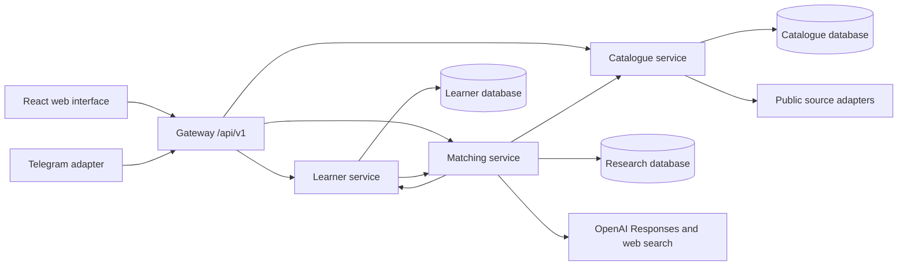

# Current architecture

The public API gateway composes three independently runnable domain services. Each service owns its data and uses REST contracts to call other services. The frontend groups user-facing functionality by feature instead of infrastructure layer.

## Ownership

| Boundary | Source | Data and responsibility |
| --- | --- | --- |
| Public API | `backend/app/gateway/` | Versioning, forwarding, auth entry points and role sessions |
| Contracts | `backend/app/contracts/` | Validated public request/response types |
| Shared infrastructure | `backend/app/core/` | Configuration, identity, HTTP clients, skill normalization |
| Learner | `backend/app/services/learners/` | Active learner projection, saved goal workspaces, revisions, CV reviews, evidence, application preparation, assessments and reminder settings |
| Catalogue | `backend/app/services/catalog/` | Imported resources/opportunities, refresh metadata, review/publication state and audit activity |
| Matching | `backend/app/services/matching/` | Goal interpretation, resource ranking, sourced research jobs, quiz generation and research persistence |
| Telegram | `backend/app/integrations/` | Separate polling worker and Telegram identity; live linking is pending |

SQLite files are local storage and ignored by Git. Learner database configuration has a PostgreSQL-capable SQLAlchemy connection foundation; catalogue/research stores use SQLite-specific implementations and require deliberate migration for distributed deployment.

## Learning flow

1. Sign-in resolves a stable account ID. Local seeded accounts are separate from anonymous browser-cookie demos.
2. A learner adds or resumes a goal; switching snapshots the previous active workspace and restores the selected plan/progress.
3. Research uses goal, market and constraints to search beyond the catalogue, then synthesizes a source-linked guide. Name, original CV and private notes are not sent to web research.
4. The learner reviews and adopts a four-week introductory plan. Weekly tasks, saved work and check-ins provide evidence of progress.
5. Quiz generation researches specific lessons on the plan's providers and validates cited lesson URLs. Answer keys remain server-side until submission. Practice supports difficulty, count and optional deadlines.
6. Preparation signals, CV review and opportunity requirements guide the next action. Signals are not verified qualifications.

## Reliability and limits

Research jobs have bounded concurrency and durable guide storage, but their runner is a single-process prototype, not a distributed queue. Jobs can resume after a process restart on owner access. AI errors preserve saved work; catalogue guidance can use explicit deterministic fallback, while researched guides/quizzes require model access.

Identity-scoped reads and account erasure have regression coverage. Local session signing and Supabase verification are implemented, but live provider account setup, production rate limiting, migrations, retention policy and deployment hardening need further work. Timers support personal practice; they are not proctoring controls. UI answer drafts are not persisted before submission.

The ordered CSS files remain separate because they contain existing style overrides. They are now grouped under `web/src/styles/`; combining them without a full visual regression pass could change the design. Backend tests retain domain-named modules in one directory because several share test helpers and one fixture boundary.
