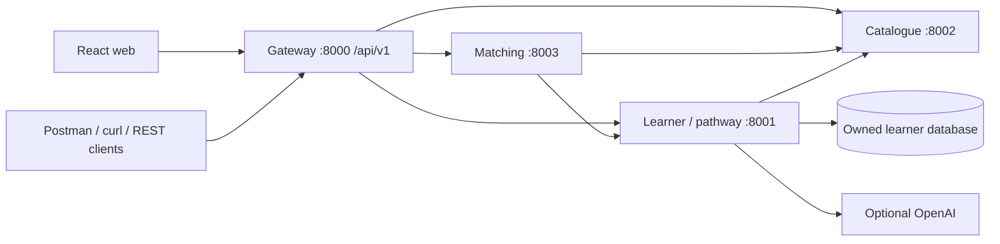

# WetinNext service architecture

## Independently runnable services

| Process         | Local port | Ownership                                                                         | Dependencies                         |
| --------------- | ---------- | --------------------------------------------------------------------------------- | ------------------------------------ |
| API gateway     | 8000       | Public route composition, versioned contracts, cookie forwarding                  | Learner, catalogue, matching         |
| Learner/pathway | 8001       | Profiles, plans, progress, check-in events, plan revisions, application interests | Catalogue over HTTP; optional OpenAI |
| Catalogue       | 8002       | Read-only starter resource and practice opportunity catalogue                     | None                                 |
| Matching        | 8003       | Stateless assessment of requirements against available learner evidence           | Learner and catalogue over HTTP      |

These are separate FastAPI processes, not merely routers inside one process. Each can be launched separately using its `main:app`, has its own OpenAPI document, and uses shared infrastructure/contracts. Only the learner service imports learner database models. Catalogue currently owns a versioned Python seed module, not a mutable database; protected editorial CRUD and catalogue storage remain future work.

## Layout

- `backend/app/main.py`: public gateway entry point.
- `backend/app/gateway/api/v1/routes.py`: explicit public forwarding routes.
- `backend/app/core/`: configuration, identity, HTTP clients, and app factory.
- `backend/app/contracts/`: typed request and response models.
- `backend/app/services/learners/`: models, database, identity dependency, pathway generation and v1 routes.
- `backend/app/services/catalog/`: owned seed catalogue and filtered v1 REST endpoints.
- `backend/app/services/matching/`: pure assessment rules and REST composition.
- `backend/templates/service/`: reusable service starter.
- `web/src/components/`: pathway tracker and opportunity match analyser.
- `web/src/api.ts`: versioned frontend API client.

## Contracts and tooling

Gateway Swagger: `http://127.0.0.1:8000/api/v1/docs`.
Gateway OpenAPI: `http://127.0.0.1:8000/api/v1/openapi.json`.
ReDoc: `http://127.0.0.1:8000/api/v1/redoc`.

Equivalent docs exist at each service port. Import `docs/api/openapi.json` or `docs/api/WetinNext.postman_collection.json` into Postman/Insomnia. The `.http` file provides REST Client examples. Core resource, opportunity, assessment, profile and adjustment contracts have explicit schemas. Dynamic progress/history payloads remain flexible dictionaries in this initial version.

Successful responses retain the first slice's JSON shapes. Failures expose `detail` and `request_id`; every response includes `X-Request-ID`. Internal client timeouts are bounded and network failures map to 503 responses. Gateway forwarding preserves status codes and Set-Cookie headers. Legacy `/api/*` paths remain temporarily available but are omitted from OpenAPI; new consumers should use `/api/v1/*`.

## Identity and security boundaries

Demo mode uses an HttpOnly browser cookie. Server-to-server clients forward only selected identity, origin, and tracing headers. Each real upstream call creates a fresh HTTP client and does not share learner cookie jars. The learner service is the authority for identity and record ownership. Matching obtains learner data only through that authenticated service. JWT verification supports configured Supabase asymmetric keys; the web sign-in flow is still pending.

Direct local service ports bind to loopback. Docker Compose exposes only the gateway port, also on loopback. The Compose configuration is a local demo, not a production deployment policy. Public deployment requires real sign-in UI, demo mode disabled, network isolation/TLS, reviewed service credentials, rate limits, secret scoping, retention/backups and operational monitoring.

## Existing data and revisions

The learner schema preserves the existing `learners` table and SQLite location. New event and revision tables are additive. Existing progress remains visible, and its latest known check-in can appear as a labelled legacy journal entry. Earlier unrecorded events are not fabricated.

Repeated immediately identical check-ins return the existing record. Changing an unfinished task's check-in creates a new journal event. This is not a full distributed idempotency-key or concurrent-write guarantee. Availability adjustments archive the previous profile/plan, change time/device only for unfinished weeks, and retain completed tasks and progress. Broad goal changes and arbitrary track pivots are not supported yet. Account deletion removes the learner, journal events and plan revisions from the active database.

The initial development bootstrap uses SQLAlchemy `create_all`; introduce explicit schema migrations before a public pilot. Learner records still contain JSON profile/plan/progress fields for compatibility. A future normalisation migration must preserve identifiers and historical evidence.

## Honest UI behaviour

- Market selection filters opportunities and does not silently change the learner's residence or eligibility.
- Search filters opportunity title, organisation and skill tags through the catalogue API.
- Weekly streak counts consecutive calendar weeks with any recorded check-in, using Lagos for Nigerian profiles and Kigali otherwise. The previous week's streak remains visible at the start of a new week until the next check-in.
- Supported requirements are labelled self-reported; completed tasks do not establish mastery.
- All current opportunities are practice examples with no real employer, deadline or application link.
- Preparation checklist ticks are temporary component state, not saved application evidence.
- Telegram opens the configured real bot URL; without one, the UI explains that it is not connected.
- The first track remains spreadsheet/data fundamentals; example frontend/API job wording is not used to imply an unsupported learning track.
