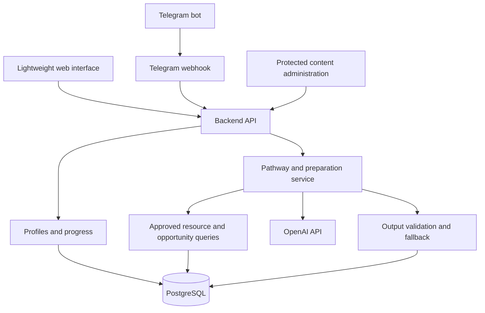

# WetinNext — System Specification and Expected Outcomes

Version: 1.0
Date: 11 October 2026
Status: Proposed implementation specification
Initial audience: University students and self-taught adult learners in Nigeria and Rwanda

## 1. Product definition

WetinNext is a lightweight AI-powered learning and opportunity guidance system. It helps learners understand their starting point, choose a realistic learning direction, practise useful skills, and prepare for relevant publicly listed opportunities.

Its central question is: **“What should I do next, given my goal, current skills, and circumstances?”**

Users can enter through either of two routes:

1. **Learning first:** “I want to learn a skill or improve in a subject.”
2. **Opportunity first:** “I want to prepare for this internship, job, scholarship, or programme.”

Both routes lead to a manageable weekly action plan. The distinguishing feature is the connection between a real opportunity requirement, evidence of the learner’s current ability, and a practical task they can do next.

WetinNext uses OpenAI models as a reasoning and explanation layer. It is an independently developed product; the wording “OpenAI’s WetinNext” must not be used unless ownership or an authorised relationship actually exists. Codex can assist implementation and testing, but is not assumed to be the production application runtime.

### Product promise

**Learn with direction. Apply with preparation. Know wetin next.**

The product promises clear, contextual next steps. It does not promise employment, admission, certification, or mastery within a fixed period.

## 2. Problem and intended value

Learners often have access to content but lack a practical way to decide:

- Which skill or topic deserves attention now.
- Which resource fits their level, available time, device, and budget.
- How to turn learning into evidence of ability.
- Whether an opportunity is relevant and whether they meet its requirements.
- What to do when they become stuck or miss a week.

WetinNext reduces the work of making these decisions through curated resources, short plans, evidence-producing tasks, and explainable opportunity preparation.

### Core product principles

- Show the next useful action before showing extensive information.
- Recommend a small number of resources rather than long lists.
- Explain recommendations in plain English.
- Treat incomplete information as uncertainty, not as a negative judgement.
- Prefer free learning and label all known costs separately.
- Adapt to phone access, limited connectivity, and limited study time.
- Preserve learner choice: recommendations can be declined or changed.
- Distinguish a verified source, a learner claim, and an AI inference.

## 3. Users and scenarios

| User | Typical need | Successful immediate outcome |
|---|---|---|
| University student | Connect studies to practical skills and internships | A weekly task and an explanation of relevant internship requirements |
| Self-taught beginner | Choose a starting point and avoid resource overload | A realistic four-week plan with suitable resources |
| Learner with an opportunity in mind | Understand a listing and prepare an application | An evidence-based gap review and deadline-aware actions |
| Returning learner | Resume after getting stuck or missing time | A smaller or rescheduled next task |
| Content administrator | Maintain trustworthy resources and opportunities | Reviewed, traceable entries with expiry and change controls |

For the initial release, assume an adult learner audience. Supporting minors requires a separately defined consent, privacy, and safeguarding design before launch.

A learner with no clear career goal should be able to choose a bounded exploratory task. The system should ask about interests and suggest a small trial, rather than assign a career with unwarranted certainty.

## 4. Scope and release boundaries

### Hackathon proof of concept

The PoC includes:

- A responsive, text-first web interface.
- A basic Telegram bot using the same backend and business rules.
- Short onboarding with optional questions.
- One fully supported track: spreadsheet and data fundamentals.
- One active four-week pathway per learner.
- A curated set of approximately 10–15 resources and 5–10 opportunities, subject to actual availability and eligibility.
- Weekly tasks, learner evidence notes, and progress check-ins.
- Opportunity browsing, requirement review, and preparation advice.
- Manual application-status tracking.
- A minimal protected content administration interface or equivalent protected import workflow.

The track is intentionally narrow for a complete demonstration. It can include academic practice tasks and internship preparation. Phone-only users receive tasks compatible with available tools or an explicit explanation when a task requires laptop access.

### Pilot extension

After validating the PoC, expand to approximately 20–30 curated resources across spreadsheet/data basics, web development basics, and career preparation. Add more subject tracks only when their resource quality and practical tasks can be maintained.

### Outside the initial scope

- Hosting full courses or replacing university learning systems.
- Automated application submission or contacting employers.
- Guaranteed job placement, admissions, or outcome predictions.
- Automatic scraping across arbitrary websites.
- A large job marketplace or employer recruitment dashboard.
- Arbitrary CV uploads, document parsing, or public learner portfolios.
- Automated grading of complex projects or certification issuance.
- Payments, social feeds, leaderboards, voice, or video lessons.
- Full multilingual support; English is the initial language.

The learner remains responsible for submitting an application through the original provider. “Applied” is self-reported unless a future authorised integration provides evidence.

## 5. End-to-end learner journeys

### A. Learning-first journey

1. Learner selects “Help me learn”.
2. Learner supplies a goal or subject, current knowledge, weekly hours, device access, and optional constraints.
3. System asks at most two necessary follow-up questions if the goal is too broad.
4. System proposes one four-week plan, including assumptions and an achievable outcome.
5. Learner accepts or requests a change.
6. Home shows this week’s goal, one or two resources, a practical task, estimated effort, and completion criteria.
7. Learner marks “Done”, “I’m stuck”, or “I need more time”.
8. System preserves completed work and adjusts unfinished work as necessary.
9. Relevant opportunities are available as a secondary view.

### B. Opportunity-first journey

1. Learner selects a curated opportunity.
2. System displays its original source, deadline, location, eligibility, and last review date.
3. Learner selects “Help me prepare”.
4. System gathers missing profile information needed for the assessment.
5. System separates mandatory eligibility, required skills, desirable skills, and application materials.
6. Each requirement is compared with profile claims and recorded learning evidence.
7. System explains strengths, gaps, and unknowns with references to listing requirements.
8. Learner receives a small set of actions that fit the remaining time.
9. Learner can save the opportunity or self-report an application.

If the deadline is too close to close a major gap, the system says so and suggests realistic immediate preparation or a future pathway. It must not compress weeks of work into an implausible schedule.

### C. Recovery journey

A learner who misses a week sees their last completed task and a suggested restart step. They can reduce weekly hours, repeat a topic, or move the target date. Completed evidence is retained; missed tasks are not silently marked complete.

## 6. Functional requirements

Requirement IDs support implementation and acceptance testing. All requirements below are required for the PoC unless marked Pilot or Later.

| ID | Capability | Required behaviour |
|---|---|---|
| FR-01 | Identity | Allow web sign-in and Telegram identity; isolate each learner’s records |
| FR-02 | Profile | Save goal, education/background, claimed skills, weekly hours, device, country, and constraints; allow unknown values |
| FR-03 | Onboarding | Permit skipping optional fields and show assumptions before accepting a plan |
| FR-04 | Pathway generation | Generate one four-week plan from approved resources and supported track templates |
| FR-05 | Weekly view | Show a goal, 1–2 resources, practical task, time estimate, and completion criteria |
| FR-06 | Plan adjustment | Support changed hours, goal, device access, or pace; retain plan versions and completed work |
| FR-07 | Check-in | Support done, stuck, and more-time outcomes with optional learner notes |
| FR-08 | Evidence | Record a project description or optional reference URL; mark it self-reported unless reviewed |
| FR-09 | Resource discovery | Filter resources by skill, level, device, format, cost, and connectivity requirements |
| FR-10 | Opportunity discovery | Filter active opportunities by type, country/location, remote availability, and supported track |
| FR-11 | Requirement assessment | Explain mandatory, desirable, satisfied, missing, and unknown requirements |
| FR-12 | Preparation advice | Produce deadline-aware actions tied to identified gaps and existing evidence |
| FR-13 | Application tracker | Support interested, preparing, applied, closed, and withdrawn; make clear that status is learner reported |
| FR-14 | Source transparency | Link resource and opportunity claims to approved source records and show review dates |
| FR-15 | Administration | Allow authorised review, publish, edit, archive, and expiry of curated content |
| FR-16 | Account control | Allow correction of profile information and deletion of the account and associated learner content |
| FR-17 | Feedback | Allow reporting a broken link, misleading listing, unsuitable resource, or incorrect recommendation |
| FR-18 | Channel linking | Pilot: link Telegram and web accounts through an explicit, single-use confirmation flow |
| FR-19 | Reminders | Pilot: optional check-in reminders with opt-out and timezone support |
| FR-20 | Application drafting | Later: draft evidence-based CV bullets or motivation text for learner review; never invent qualifications |

Before channel linking is implemented, web and Telegram identities remain separate and this limitation is disclosed. Matching names or email text must never automatically merge accounts.

## 7. User interface specification

### Web screens

1. **Welcome:** Short explanation and the two entry routes.
2. **Profile setup:** Conversational form with progress and skip controls.
3. **Plan preview:** Four-week overview, expected outcome, assumptions, and accept/change actions.
4. **My week:** Primary home screen with the current task and check-in controls.
5. **Opportunities:** A short list of relevant, active listings.
6. **Opportunity detail:** Source facts, eligibility, deadline, and “Help me prepare”.
7. **Preparation review:** Requirement-by-requirement explanation and next actions.
8. **My applications:** Simple status list linking to original listings.
9. **Settings:** Profile correction and account deletion; notification preferences when supported.
10. **Admin:** Content review and publication controls for authorised users.

### Telegram interactions

Support `/start`, `/plan`, `/week`, `/opportunities`, `/progress`, `/help`, and `/deleteaccount`. Use buttons for common check-ins and short messages with links. Long outputs should be split into readable messages.

If a response takes time, acknowledge the request and provide the result when ready. Commands must retrieve existing state without regenerating a plan unnecessarily.

### Accessibility and low-data behaviour

- Use responsive layouts, readable typography, semantic HTML, keyboard support, and labelled controls.
- Avoid mandatory media, decorative downloads, and autoplay.
- Show text summaries before external links.
- Label video-heavy and laptop-required resources.
- Cache the last loaded weekly plan on web where feasible; account deletion/sign-out clears learner-specific local data.
- Reading cached content does not imply full offline synchronisation. Offline check-in submission is outside the PoC unless explicitly implemented.

## 8. Pathway and opportunity intelligence

### Pathway generation pipeline

1. Validate profile inputs and normalise the goal to a supported track.
2. Ask for critical missing information or record transparent assumptions.
3. Retrieve approved resource candidates using skill and constraint metadata.
4. Exclude incompatible resources where constraints are explicit.
5. Provide the model with the profile, resource IDs, track template, and output schema.
6. Generate goals, weekly actions, explanations, and resource references.
7. Validate the output before saving or displaying it.
8. Save the accepted plan as a versioned record.

The model may use only supplied resource IDs for recommendations. It must not create URLs, claim an unreviewed source is verified, or invent availability.

### Plan validation rules

- Exactly four weeks for the PoC.
- One or two approved resources per week.
- Estimated tasks fit the stated weekly time budget.
- Every week has an observable completion criterion.
- Required devices and known costs match explicit learner constraints.
- No promise that course completion guarantees work.
- Unsupported goals receive an honest limitation and an available alternative.

### Opportunity assessment

First apply deterministic checks to known facts such as deadline, country restrictions, education stage, and required equipment. Missing profile values produce “Unknown”, not automatic rejection.

Then use the model to explain skills and preparation using structured listing requirements and learner evidence.

Use summary labels such as:

- **Worth considering:** Known mandatory conditions appear satisfied; explain remaining uncertainties.
- **Some preparation needed:** Meaningful skills or materials remain incomplete.
- **Eligibility requirement missing:** A known mandatory condition is unmet.
- **More information needed:** Essential facts are missing or ambiguous.

Do not present a numerical hiring probability. Preparation guidance is an assessment of available information, not an employer decision.

### Evidence model

A skill may be supported by a learner claim, completed task, linked project, or reviewed project. These levels remain distinct. A completed check-in alone does not establish mastery, and an external URL is not automatically inspected or validated.

### AI reliability controls

- Treat listings, learner text, and external content as untrusted data, never operating instructions.
- Use structured model output with application-side schema validation.
- Associate recommendations with source IDs and listing versions.
- Reject invalid IDs and unsupported claims; permit one bounded repair attempt.
- Fall back to a reviewed track template if generation remains invalid or unavailable.
- Record model configuration and prompt version for reproducibility without logging unnecessary personal data.
- Never let model output directly change permissions, submit applications, or execute arbitrary tools.

## 9. Curated resource and opportunity base

### Resource metadata

Store title, provider, canonical source URL, skill tags, level, format, estimated effort, language, device requirements, connectivity category, learning cost, certificate cost, access prerequisites, review date, reviewer, and publication status.

“Free learning” and “free certificate” are separate attributes. Unknown information must be labelled unknown. Provider reputation alone does not establish the suitability of an individual course.

### Opportunity metadata

Store title, organisation, opportunity type, canonical application URL, country/location, remote policy, eligibility, required and desirable skills, required documents, published deadline and its timezone if supplied, deadline certainty, source review date, listing version, and status.

If only a date is supplied, retain that precision and display “Confirm closing time with provider.” Do not invent a closing timezone. Automatically exclude clearly expired listings from active recommendations; ambiguous deadlines require review.

### Curation workflow

Draft → review → published → archived/expired.

During the PoC, manually inspect the original source before publication. For the pilot, aim to review active opportunity listings at least weekly and resources monthly, with urgent rechecks for reported problems. These are proposed operating targets, not claims of existing coverage.

Public availability does not automatically permit bulk collection or republication. Use permitted APIs/feeds, authorised integrations, or manual entries with short factual summaries and original links. Avoid collecting applicant data from providers.

A reachable URL is not proof that a listing is legitimate or still open. Keep automated link checks separate from editorial review. If automated fetching is introduced, restrict destinations, timeouts, redirects, and response sizes to prevent server-side request forgery and excessive downloads.

## 10. Proposed architecture

Use a modular monolith for simplicity: one backend, one database, and shared services for web and Telegram.

### Suggested implementation stack

These are provisional choices, not claims about an existing codebase:

- Web: React, TypeScript, and Vite.
- Backend: Python and FastAPI.
- Persistence: PostgreSQL with schema migrations.
- Telegram: webhook adapter using the Telegram Bot API.
- AI: server-side OpenAI integration behind a small provider interface.
- Background work: scheduled maintenance for expiry and content review reminders; add a queue only if usage requires it.
- Deployment: a static web host, backend service, and managed database.

Choose the production model after evaluating quality, latency, structured output support, and current pricing. Keep model selection configurable. Verify current SDK and API documentation during implementation.

API keys and Telegram tokens must stay on the server. Web and Telegram must call shared services rather than maintain separate recommendation logic.

## 11. Data model

| Entity | Main fields and relationships |
|---|---|
| User | ID, created time, account status, locale |
| Identity | User ID, provider, unique provider subject; no implicit account merging |
| LearnerProfile | User ID, education, goal, country, device, weekly hours, constraints, updated time |
| SkillClaim | User ID, skill ID/name, claimed level, claim source |
| Track | ID, name, supported goals, prerequisites, reviewed template |
| Resource | Curated metadata, status, version, reviewer |
| Opportunity | Curated metadata, deadline precision, status, version, reviewer |
| OpportunityRequirement | Opportunity ID, category, mandatory flag, source text/reference |
| Pathway | User ID, track ID, goal, version, assumptions, status, generation metadata |
| WeeklyTask | Pathway ID, week index, goal, instructions, effort, completion criterion, status |
| TaskResource | Task ID, resource ID; preserves references to approved content |
| CheckIn | Task ID, user ID, outcome, note, timestamp |
| LearningEvidence | User ID, task ID, description, optional URL, verification level |
| OpportunityAssessment | User ID, opportunity version, profile/evidence snapshot reference, findings, created time |
| Application | User ID, opportunity ID, self-reported status, notes, updated time |
| ContentReport | User ID optional, content ID, reason, review status |
| AdminAudit | Administrator, action, entity, timestamp; avoid duplicating sensitive learner content |

Enforce ownership checks for learner records and foreign-key relationships. Keep completed pathways readable when resources are archived, while clearly indicating archived or unavailable links.

Deleting a learner removes their profile, identities, pathways, evidence, assessments, and applications. Shared curated content remains. Define backup expiry and operational log retention before a public pilot; disclose any delay in deletion from backups.

## 12. API contract outline

All learner endpoints require authenticated identity. Administration requires a separate authorisation role. Names may be refined during implementation while preserving behaviour.

| Method and route | Purpose |
|---|---|
| `GET /api/me` | Read own account and profile |
| `PATCH /api/me/profile` | Update permitted profile fields |
| `DELETE /api/me` | Delete own account after explicit confirmation |
| `GET /api/tracks` | List supported learning tracks |
| `POST /api/pathways` | Generate a plan preview using an idempotency key |
| `POST /api/pathways/{id}/accept` | Accept own plan and activate it |
| `GET /api/pathways/current` | Read active pathway |
| `POST /api/pathways/{id}/adjust` | Create a revision with stated changes |
| `POST /api/tasks/{id}/check-ins` | Save an idempotent progress event |
| `POST /api/tasks/{id}/evidence` | Add a learner evidence note/reference |
| `GET /api/opportunities` | Browse active filtered listings |
| `GET /api/opportunities/{id}` | Read source-backed listing details |
| `POST /api/opportunities/{id}/assessments` | Create or reuse a preparation assessment |
| `GET /api/applications` | List own application records |
| `PUT /api/applications/{opportunity_id}` | Set own self-reported status |
| `POST /api/content-reports` | Report a content issue |
| `POST /api/telegram/webhook` | Receive authenticated Telegram updates |
| `/api/admin/resources` | Protected resource management |
| `/api/admin/opportunities` | Protected opportunity management |

Validate lengths, enums, ownership, and state transitions. Use consistent errors containing a safe message and request ID. A plan generation failure must not erase an existing accepted plan.

Deduplicate Telegram update IDs and repeated client requests. Verify the configured Telegram webhook secret. A user cannot access another learner’s plan by changing an ID.

## 13. Security, privacy, and operational requirements

- Use HTTPS, secure session handling, protected secrets, and least-privilege database access.
- Authorise every learner record operation and every admin mutation.
- Rate-limit expensive AI requests and authentication actions.
- Collect only the profile information necessary for guidance; do not require government IDs, bank details, or date of birth.
- Explain what profile data is sent to the AI provider and why. Do not promise provider retention behaviour without verifying deployment settings and terms.
- Avoid full conversation logging by default. Redact tokens and unnecessary personal information from diagnostics.
- Treat optional evidence URLs as plain references in the PoC; do not automatically fetch arbitrary learner URLs.
- Keep analytics limited to necessary product events; do not send raw learner text to analytics tools.
- Require confirmation for account deletion and protect it against accidental or forged requests.
- Keep reminders opt-in when introduced. Do not contact employers or submit applications on a learner’s behalf.

Country-specific legal requirements, hosting arrangements, and privacy notices must be reviewed before a public pilot. This specification does not establish legal compliance.

## 14. Non-functional targets

The following are proposed acceptance targets to measure, not results already achieved:

| Area | Initial target |
|---|---|
| Web weight | Initial compressed application assets at or below 500 KB, excluding optional external resources |
| Normal API requests | p95 below 1 second under the agreed PoC load, excluding AI and external providers |
| AI guidance | p95 below 30 seconds in measured normal conditions; acknowledge waiting and use a bounded timeout/fallback |
| Test load | Demonstrate 10 concurrent learners without lost or cross-account progress |
| Usability | Core web journey usable at 360 px width with keyboard-accessible controls |
| Reliability | Retrying a check-in does not duplicate or lose progress |
| Maintainability | Shared business logic across channels, migrations, configurable model/provider settings |
| Cost visibility | Record model usage and estimated cost per generation using verified pricing at implementation time |

Measure latency with provider, environment, and sample size recorded. Do not claim full low-connectivity or accessibility compliance from a small demo.

## 15. Failure and edge-case behaviour

| Condition | Expected response |
|---|---|
| Incomplete profile | State assumptions; ask only for information essential to the next decision |
| Unsupported goal | Explain current coverage and offer a relevant supported route |
| No compatible resource | State the gap; do not invent a resource or ignore device constraints |
| No relevant opportunity | Show no-match state and continue the learning plan |
| Expired listing | Disable active preparation recommendation; retain historical application record |
| Listing changed | Mark existing assessment as based on an older version and offer reassessment |
| Resource removed | Flag it and substitute an approved compatible resource where available |
| AI unavailable or invalid | Preserve saved state and offer reviewed template guidance or retry |
| Network loss | Preserve the last saved state; show that unsaved changes were not submitted |
| Mandatory criterion unknown | Ask for clarification or display unknown; avoid a confident eligibility decision |
| Learner misses time | Reschedule unfinished work while retaining completed tasks |
| Suspicious listing | Unpublish pending review and prevent new recommendations |

## 16. Acceptance tests and evaluation

### Required demonstration tests

1. A new learner with a laptop and three weekly hours receives an approved four-week spreadsheet plan that fits that time budget.
2. A phone-only learner receives compatible tasks or an explicit limitation; laptop-only tasks are not silently recommended.
3. A learner can skip optional profile fields and see the resulting assumptions.
4. A “Done” check-in is saved once even when retried; completed work survives plan adjustment.
5. An “I’m stuck” check-in produces a smaller exercise or explanation relevant to the task.
6. A selected opportunity displays its original source, deadline precision, eligibility, and review date.
7. An assessment separates mandatory requirements, desirable skills, evidence, gaps, and unknowns.
8. A known mandatory eligibility mismatch is not described as eligibility satisfied.
9. A deadline that has passed prevents active recommendations.
10. An invalid model resource ID or invented link is rejected before display.
11. An AI timeout does not destroy the current plan and produces a usable fallback or clear retry state.
12. One learner cannot retrieve or change another learner’s records.
13. Telegram duplicate delivery does not create duplicate plans or check-ins.
14. Account deletion removes associated learner records from the active database.
15. Admin-only routes reject ordinary learner credentials.

### Evaluation approach

Use a small fixed evaluation set with realistic profiles, device constraints, incomplete information, and listings with different eligibility conditions. Review recommendation relevance, factual grounding, time realism, and explanation clarity.

Critical release conditions: no invented sources in the evaluation set, no cross-account access, no known mandatory mismatch presented as satisfied, and no loss of completed progress during adjustment. These are test-set acceptance conditions, not a guarantee that all future model outputs will be error-free.

Conduct a pilot usability study with approximately 10–20 consenting adult learners across the intended audiences. Record cohort size and country coverage. Proposed usability target: at least 80% can find their weekly task and explain their next action without facilitator help. Revise this target after observing baseline behaviour.

## 17. Expected outcomes

### What the learner should receive

- A clear starting point based on their stated knowledge and goal.
- One manageable four-week pathway with free, traceable resources where available.
- A practical action for the current week and a way to recognise completion.
- A record of tasks and self-reported evidence they can use when preparing applications.
- A transparent explanation of opportunity fit, gaps, and unknown eligibility conditions.
- Preparation advice that respects time remaining, device access, and budget.
- A way to recover from interruptions without starting again.

### What the hackathon should demonstrate

A complete working loop:

**Profile → approved plan → weekly task → check-in → adjusted next step → relevant opportunity → requirement review → preparation actions → self-reported application status.**

Deliverables should include runnable web and Telegram interfaces, the shared backend, database migrations, reviewed seed content with source metadata, configuration instructions, and acceptance-test evidence.

### What success can be measured by

| Outcome | Measurement | Limitation |
|---|---|---|
| Clearer direction | Learner can describe the next action after onboarding | Self-report and small usability samples |
| Useful learning activity | Weekly task completion and evidence notes | Completion does not establish mastery |
| Continued engagement | Return and check-in rates across four weeks | Requires a longitudinal pilot |
| Better preparation | Learner understands requirements and completes preparation actions | Does not establish improved hiring odds |
| Trustworthy guidance | Source validity and reviewer-rated explanation quality | Requires continuing review |
| Sustainable operation | Measured generation cost, latency, and curation effort | Depends on real usage and provider settings |

Employment, internship acceptance, and scholarship awards may be tracked through optional learner reports later. They are longer-term outcomes and must not be presented as demonstrated PoC impact or caused by WetinNext without appropriate evidence.

## 18. Example demonstration

**Learner:** A university student in Nigeria, basic spreadsheet familiarity, laptop access, three hours per week, interested in a data internship.

**Plan outcome:** Build a small spreadsheet project that cleans a sample dataset, applies formulas, and presents a chart with a short explanation.

- Week 1: Practise sorting/filtering and create an expense tracker.
- Week 2: Use basic formulas and check the accuracy of calculations.
- Week 3: Clean a small dataset and create an understandable chart.
- Week 4: Improve the project and write a short explanation suitable for a portfolio or CV discussion.

**Opportunity review:** A real curated internship may ask for spreadsheets, SQL, student status, and location availability. WetinNext distinguishes the learner’s self-reported student status, their spreadsheet project evidence, their missing SQL evidence, and any unknown location requirements.

**Suggested response:** “Your spreadsheet project gives you something relevant to discuss. You have not yet recorded SQL experience. Confirm the listing’s student and location conditions. If eligible, consider applying with an honest description of your current skills while beginning an introductory SQL exercise.”

The example is illustrative. A real demonstration must use a source-checked listing; any synthetic listing must be clearly labelled and cannot imply a real employer opportunity.

## 19. Implementation sequence

1. **Content foundation:** Define the supported track, review resources and opportunities, and prepare realistic evaluation profiles.
2. **Core system:** Implement identity, profile persistence, schema migrations, protected content administration, and ownership checks.
3. **Learning loop:** Implement plan generation, validation, weekly task display, check-ins, evidence notes, and adjustment.
4. **Opportunity loop:** Implement browsing, deterministic eligibility checks, model explanations, preparation actions, and status tracking.
5. **Telegram adapter:** Connect onboarding and core actions to the same services; test deduplication and identity boundaries.
6. **Verification and demo:** Run acceptance tests, review generated advice, measure latency and cost, and prepare a reproducible demo.
7. **Pilot preparation:** Finalise privacy/retention decisions, recruit testers, review feedback, and decide whether to expand tracks.

Do not expand track count or automate collection before the complete learner loop works reliably.

## 20. Decisions required before implementation or public pilot

| Decision | Proposed default |
|---|---|
| Primary learning track | Spreadsheet and data fundamentals |
| Initial plan length | Four weeks, adjusted through check-ins |
| Web identity provider | Select a maintained authentication solution before coding auth |
| Telegram/web linking | Separate in PoC; explicit linking in pilot |
| Content acquisition | Manual curation from original permitted sources |
| User evidence | Text notes and optional reference URLs |
| Automated submissions | Excluded |
| Hosting and AI model | Select after current documentation, cost, and privacy review |
| Reminder delivery | Excluded from PoC; opt-in in pilot |
| Retention and backups | Define and disclose before collecting public-pilot data |

## 21. Definition of done

The PoC is complete when a learner can use the web interface and basic Telegram flow to obtain and follow a grounded plan, save progress, receive an adapted next step, review a real opportunity, understand the preparation gaps, and record an application status. The shared backend must enforce ownership, preserve completed progress, reject invented resource references, and handle provider failures without losing saved state.

The finished system should make one practical result visible: **the learner knows what to do next and why it matters to their goal.**
